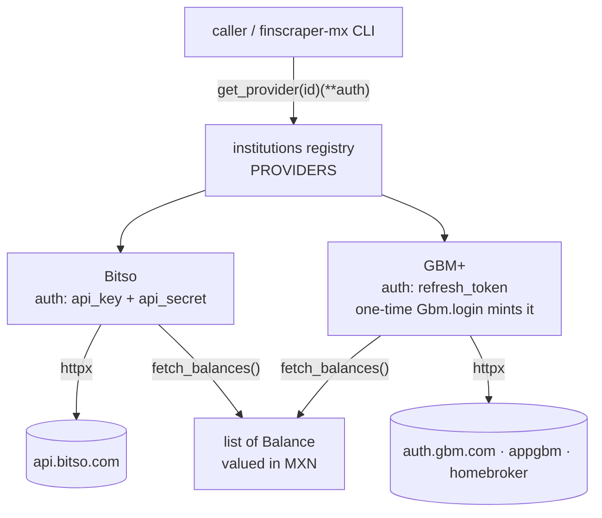

# AGENTS.md — finscraper-mx

Orientation for AI agents (and humans). Read this first; you shouldn't need to read the whole repo.

## What this is

A small Python library of **read-only balance scrapers** for Mexican financial institutions. Each
institution is a **provider**; all providers are used the **same way** and return the same `Balance` shape.

## The one interface (do not diverge)

```python
from finscraper_mx import get_provider

provider = get_provider("bitso")(api_key="…", api_secret="…")   # build with the institution's auth fields
balances = provider.fetch_balances()                            # -> list[Balance]
```

A provider is a `core.Provider` subclass with: `id` (matches the registry key), `name`, `auth_fields`
(tuple), and `fetch_balances() -> list[Balance]`. Reads always go through `fetch_balances()`. A one-off
credential helper (e.g. GBM's `login` classmethod to mint a refresh token) is allowed, but it is **not**
the documented "call" — never add provider-specific public read methods or direct-import usage.

## Architecture



Providers at a glance (keep in sync with the diagram and the README table):

| id | auth fields | reads | source |
|----|-------------|-------|--------|
| `bitso` | `api_key`, `api_secret` | per-coin, valued in MXN | official REST API |
| `gbm` | `refresh_token` (one-time `Gbm.login`) | per-strategy, in MXN | auth + appgbm + homebroker |

Detailed per-provider call flows: [`docs/flows/bitso.md`](docs/flows/bitso.md) ·
[`docs/flows/gbm.md`](docs/flows/gbm.md) (one `docs/flows/<id>.md` per provider).

## Conventions

- **Stateless.** The library never persists credentials or sessions — the caller passes auth in and stores
  it. (GBM's refresh token is the caller's to keep; read-only, but trade-capable — keep it off shared hosts.)
- **No secrets, ever, in the repo.** Account ids, tokens, passwords live only in local gitignored files
  (`*_config.json`, `*_tokens.json`, `*_values.json`, `auth*.json`, `.env`, `.har`). Nothing personal is
  hardcoded (a fixed public app id like GBM's `CLIENT_ID` is fine).
- **One runtime dependency:** `httpx` (declared in `pyproject.toml`, no per-provider extras).
- **Money is `Decimal`**, never float. `Balance.amount` is exact.

## Workflows

- **Add a provider** → use the `add-provider` skill (`.claude/skills/add-provider`).
- **Before any commit/push** → run the gate and only proceed on `COMPLIANCE OK`:
  ```bash
  .venv/bin/python .claude/skills/precommit-compliance/scripts/check_compliance.py
  ```
  It checks provider compliance, per-provider tests, README sync, no tracked secrets, and a green suite.
- **Dev setup:** `python -m venv .venv && .venv/bin/pip install -e ".[dev]" && .venv/bin/pytest`
