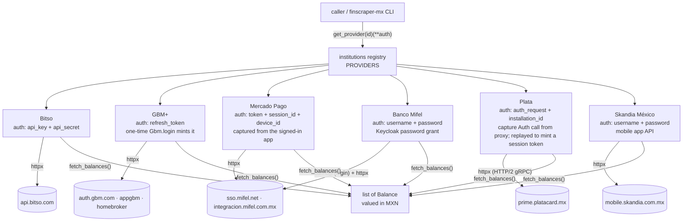

# CLAUDE.md — finscraper-mx

Auto-loaded orientation for agents (and humans). Read this first; you shouldn't need to read the whole repo.

## What this is

A small Python library of **read-only balance scrapers** for Mexican financial institutions. Each
institution is a **provider**; all providers are used the **same way** and return the same `Balance` shape.

## The one interface (do not diverge)

```python
from finscraper_mx import get_provider

provider = get_provider("bitso")(api_key="…", api_secret="…")   # build with the institution's auth fields
balances = provider.fetch_balances()                            # -> list[Balance]
```

A provider is a `core.Provider` subclass with `id` (matches the registry key), `name`, `auth_fields`
(tuple), and `fetch_balances() -> list[Balance]`. Reads always go through `fetch_balances()`. A one-off
credential helper (e.g. GBM's `login` classmethod) is allowed but is **not** the documented "call" — never
add provider-specific public read methods or direct-import usage.

## Architecture



| id | auth fields | reads | source |
|----|-------------|-------|--------|
| `bitso` | `api_key`, `api_secret` | per-coin, valued in MXN | official REST API |
| `gbm` | `refresh_token` (one-time `Gbm.login`) | per-strategy, in MXN | auth + appgbm + homebroker |
| `mercado_pago` | `token`, `session_id`, `device_id` (captured app session) | per balance tab, in MXN | mobile home-hub API |
| `mifel` | `username`, `password` | account balances, in MXN | Keycloak + integracion API |
| `plata` | `auth_request`, `installation_id` (capture the Auth call from proxy; replayed to mint a session token) | accounts + investment, in MXN (Acciones via Google FX) | mobile app gRPC API |
| `skandia` | `username`, `password` | Fondo de Ahorro, in MXN | SKANDIA NET MX mobile app API |

Detailed per-provider call flows: [`docs/flows/bitso.md`](docs/flows/bitso.md) ·
[`docs/flows/gbm.md`](docs/flows/gbm.md) ·
[`docs/flows/mercado_pago.md`](docs/flows/mercado_pago.md) ·
[`docs/flows/mifel.md`](docs/flows/mifel.md) ·
[`docs/flows/plata.md`](docs/flows/plata.md) ·
[`docs/flows/skandia.md`](docs/flows/skandia.md) (one `docs/flows/<id>.md` per provider).

## Rules

Full list in [`.claude/rules/providers.md`](.claude/rules/providers.md). In short:

- **Standard interface only** — `get_provider(id)(**auth).fetch_balances()`; no bespoke public read methods.
- **Stateless** — the library never persists credentials or sessions; the caller passes auth in.
- **No secrets in the repo** — account ids, tokens and passwords live only in local gitignored files
  (`*_config.json`, `*_tokens.json`, `*_values.json`, `auth*.json`, `.env`, `.har`). A fixed public app id
  (e.g. GBM's `CLIENT_ID`) is fine; nothing personal is hardcoded.
- **Runtime dependencies declared in `pyproject.toml`** (`httpx`, `curl-cffi`). **Money is `Decimal`**, never float.

## Layout

```
src/finscraper_mx/
  core.py                   Provider, Balance, AccountKind, errors
  institutions/__init__.py  PROVIDERS registry {id: (module, class)} + get_provider()
  institutions/<id>.py      one provider per institution (bitso, gbm, …)
  cli.py                    finscraper-mx list / balances <id> --auth auth.json
tests/test_<id>.py          one test file per provider (mocked httpx, fake data)
docs/flows/<id>.py          detailed mermaid call-flow per provider
.claude/                    rules · skills · commands · agents · hooks · settings.json
```

## .claude/ structure

- **`rules/`** — repo conventions (`providers.md`).
- **`skills/`** — `scaffold-provider` (scaffold a provider, with templates).
- **`commands/`** — `/add-provider <institution>` (runs the provider-builder agent, which follows the skill).
- **`hooks/precommit_gate.py`** — one file: the hook that blocks commit/push, and `--check` for a manual gate run.
- **`agents/`** — `provider-builder` (subagent that adds/maintains providers end to end).
- **`settings.json`** — permissions for the dev commands + the pre-commit hook.

## Prerequisites

- Python 3.12 or newer.

**Agents:** check `python3 --version` before running tests or the gate.

## Workflows

- **Add a provider** → `/add-provider <institution>`, the `scaffold-provider` skill, or hand it to the `provider-builder` agent.
- **Before commit/push** → the hook runs the gate automatically; run it by hand with:
  ```bash
  .venv/bin/python .claude/hooks/precommit_gate.py --check
  ```
  It checks provider compliance, per-provider tests, README + architecture diagram + flow docs in sync,
  no tracked secrets, and a green suite.
- **Dev setup:** `python -m venv .venv && .venv/bin/pip install -e ".[dev]" && .venv/bin/pytest`
