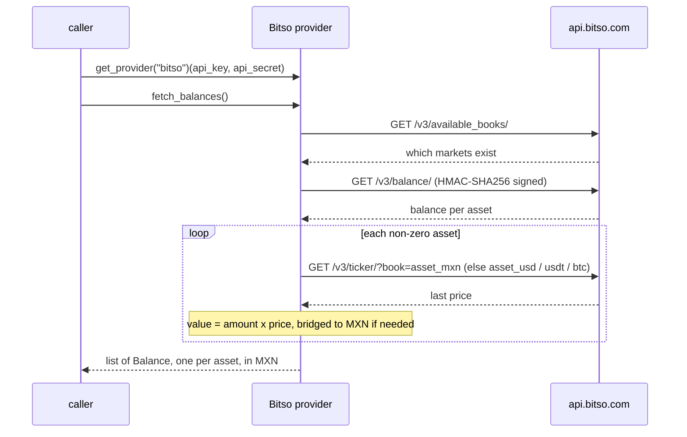

# Bitso — flow

Getting the credentials: [`docs/credentials.md`](../credentials.md#bitso).

Reads one `Balance` per non-zero asset, valued in MXN (bridging through USD/USDT/BTC when an asset has no
direct MXN market).

## Auth

A read-only API key: `api_key` and `api_secret`, created on Bitso's site. Every request is signed
HMAC-SHA256 with the secret. The key needs only the permission to read balances.

## Read — `fetch_balances()`

## Balance mapping

One `Balance` per non-zero asset, `kind` `crypto` (MXN itself is `checking`). The amount is the holding
times its last price, valued in MXN directly when an `asset_mxn` market exists, otherwise bridged through
the first of `asset_usd` / `asset_usdt` / `asset_btc` that does (each bridge having an MXN market).
MXNB, the peso stablecoin that Bitso vaults hold, has no MXN market and is valued 1:1 (no ticker call).
Any other asset with no path to MXN raises `FinscraperError`.
