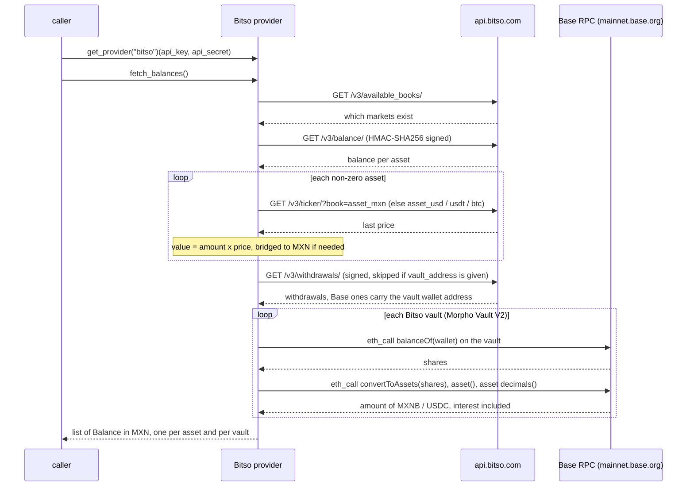

# Bitso — flow

Getting the credentials: [`docs/credentials.md`](../credentials.md#bitso).

Reads one `Balance` per non-zero asset, valued in MXN (bridging through USD/USDT/BTC when an asset has no
direct MXN market), plus one per Bitso Vault (Bóveda) position, read on-chain.

## Auth

A read-only API key: `api_key` and `api_secret`, created on Bitso's site. Every request is signed
HMAC-SHA256 with the secret. The key needs the permission to read balances, plus "Ver información de
cuenta" for vaults (it lets the provider list withdrawals; it can't move money). Optionally,
`vault_address` gives the vault wallet directly.

## Read — `fetch_balances()`

## Balance mapping

One `Balance` per non-zero asset, `kind` `crypto`. The amount is the holding times its last price, valued
in MXN directly when an `asset_mxn` market exists, otherwise bridged through the first of `asset_usd` /
`asset_usdt` / `asset_btc` that does (each bridge having an MXN market). MXNB, the peso stablecoin, has no
MXN market and is valued 1:1. Any other asset with no path to MXN raises `FinscraperError`.

## Vaults (Bóvedas)

Bitso Vaults aren't in Bitso's API. Moving MXNB or USDC into a vault sends it (as a Base ERC-20
withdrawal) to a wallet in the user's name on Base, which deposits it into a Morpho Vault V2:

| Vault | Contract on Base | Valued as |
|---|---|---|
| Juno MXNB Prime | `0x08cc279532f159BdB450eBc0bAf6562f585Ded58` | MXNB, 1:1 MXN |
| USDC vault | `0x39E18c066187c83e860801Befe45aE8ecd021575` | USD, via `usd_mxn` |

The provider takes the wallet from `vault_address`, or else from the destination of the account's Base
withdrawals, reads its vault shares with `balanceOf`, and converts them with `convertToAssets`, so the
amount includes the interest earned. Each position is one `Balance` named `Bóveda MXNB` / `Bóveda USDC`,
`kind` `investment`. If the key can't list withdrawals (error `0202`) and no `vault_address` is given,
vaults are skipped. A new Bitso vault needs its contract added to `VAULTS`.
