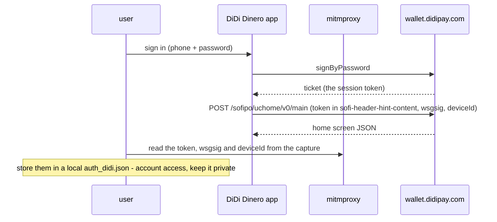
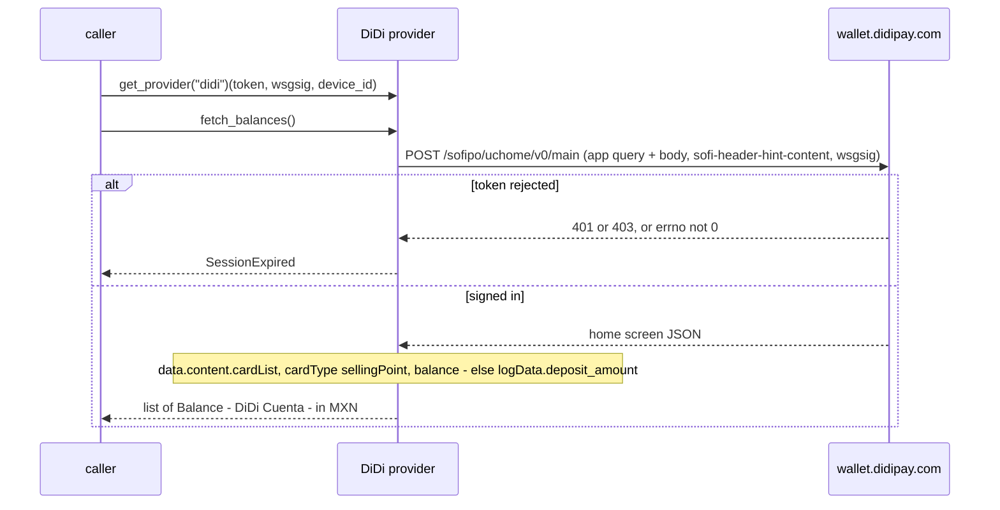

# DiDi — flow

Auth: the signed-in DiDi Dinero app's session, captured by the user (e.g. with mitmproxy): the SOFIPO
session `token` (inside the `sofi-header-hint-content` header), the `wsgsig` integrity header and the
`device_id`. The provider never logs in; it replays the captured session against the app's home-screen
endpoint and reads the DiDi Cuenta balance, in MXN.

## One-time setup (the user captures their own app session)

## Each read — `fetch_balances()`

