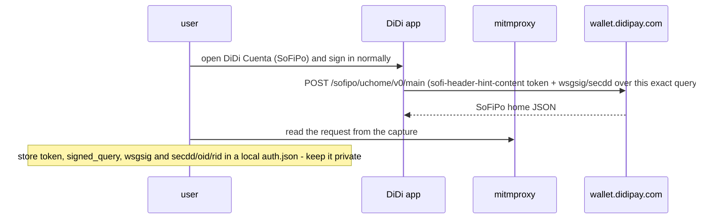
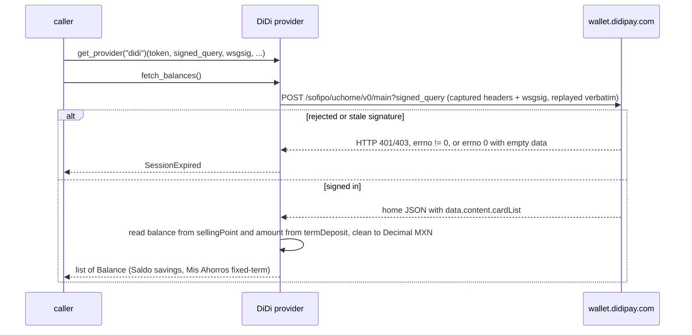

# DiDi — flow

Auth: the signed-in mobile app's request, captured by the user (e.g. with mitmproxy). The app signs
every request with a per-request `wsgsig`/`secdd` signature computed natively over the exact query
string and body; it can't be reproduced off-device and only validates the request it was made for, so
the provider never logs in and never rebuilds the request — it replays the captured one verbatim. The
required pieces are the session `token` (from the `sofi-header-hint-content` header), the exact captured
query string (`signed_query`) and the `wsgsig`; pass the `secdd_authentication`, `secdd_challenge`,
`oid` and `rid` the app sent with it, and override `sofi_hint`, `didi_hint` or `body` if the capture
differs from the defaults. Reads one `Balance` per balance card of the SoFiPo home — `sellingPoint`
(Saldo, savings) and `termDeposit` (Mis Ahorros, fixed-term) — in MXN.

## One-time setup (the user captures their own app session)

## Each read — `fetch_balances()`

Notes:

- The balance arrives as a display string (e.g. `10,058.37`); the provider strips separators and the
  `+` of `totalEarning` and parses `Decimal`.
- `wsgsig`/`secdd` are request-bound and short-lived: a captured signature only validates its own
  request, and a rebuilt request returns `errno 0` with empty `data`. The provider therefore replays the
  captured `signed_query` and signature verbatim; recapture when a read raises `SessionExpired`.
