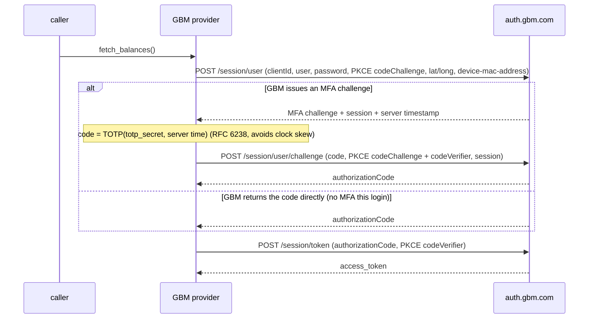
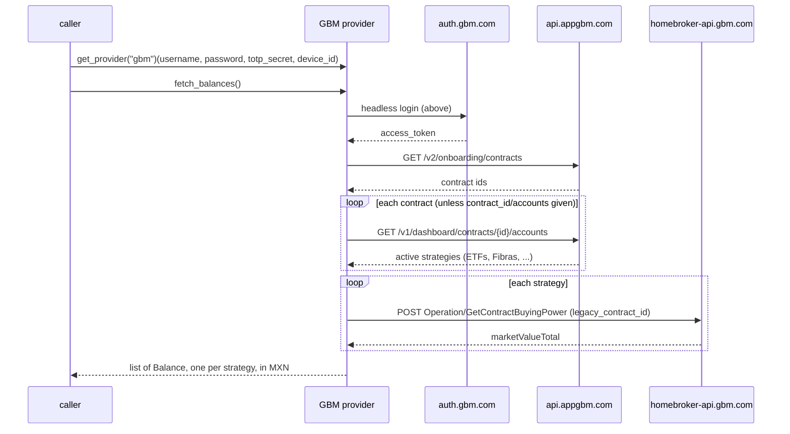

# GBM — flow

Getting the credentials: [`docs/credentials.md`](../credentials.md#gbm).

Reads one `Balance` per active strategy across every contract, valued in MXN.

## Auth

Fully headless: `username` + `password` + `totp_secret` + `device_id`. The provider generates GBM's
6-digit MFA code itself from `totp_secret` (the account's authenticator seed, RFC 6238: base32 secret,
HMAC-SHA1, 30 s) and runs GBM's mobile PKCE login on every read. No refresh token to babysit and no
human step. GBM allows **one authorized device and one session at a time**, so a read logs the phone
app's session out (the phone stays an authorized device; just sign in again).

An unauthorized `device_id` (the phone took the single-device slot) makes `/session/user` fail and the
provider raises `SessionExpired`; a rejected code raises `AuthRequired`.

## Read — `fetch_balances()`

## Setup — take over the TOTP seed once

One-time, Claude-assisted (the `capture-credentials` skill), not through the provider. GBM's active seed
can't be read (`GET /security-settings/totp/key` mints fresh enrollment secrets), so setup **activates a
seed the scraper controls**: log in → `GET /security-settings/totp/key` (fresh seed) → generate its code
against server time → `POST /security-settings/totp/confirm` to activate → store as `totp_secret`. This
**replaces the GBM app's own authenticator** (re-enrolling it in the app rotates the seed and breaks the
scraper). `device_id` is the `device-mac-address` from a one-time app capture. See
[`docs/credentials.md#gbm`](../credentials.md#gbm).

## Balance mapping

One `Balance` per active strategy, `kind` `investment`, amount = the strategy's `marketValueTotal` in MXN.
Contracts and their strategies are discovered from the dashboard unless the caller pins them with
`contract_id` / `accounts`. An unexpected `marketValueTotal` raises `LayoutChanged`.
