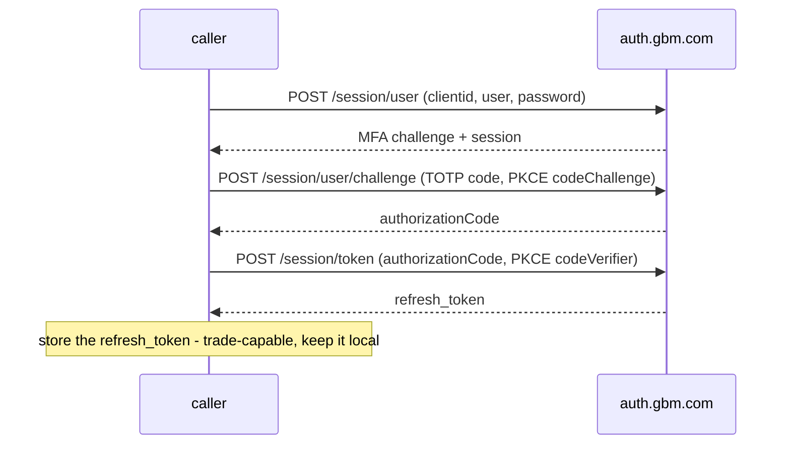
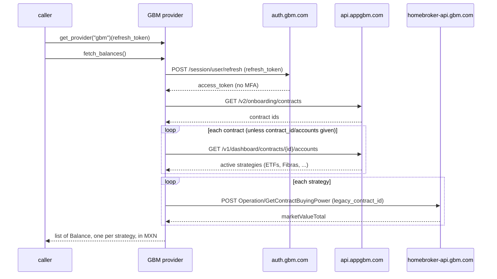

# GBM+ — flow

Getting the credentials: [`docs/credentials.md`](../credentials.md#gbm).

Reads one `Balance` per active strategy across every contract, valued in MXN.

## Auth

A `refresh_token`, minted once by `Gbm.login(user, password, code)` (OAuth2 PKCE + TOTP MFA). Afterwards
reads are silent (refresh only) until the token expires, then log in again. The token is trade-capable, so
keep it local.

## Read — `fetch_balances()`

## Balance mapping

One `Balance` per active strategy, `kind` `investment`, amount = the strategy's `marketValueTotal` in MXN.
Contracts and their strategies are discovered from the dashboard unless the caller pins them with
`contract_id` / `accounts`. An unexpected `marketValueTotal` raises `LayoutChanged`; a lapsed refresh token
raises `SessionExpired`.
