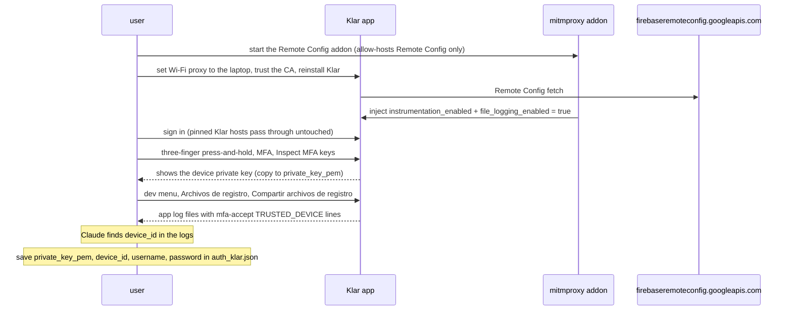
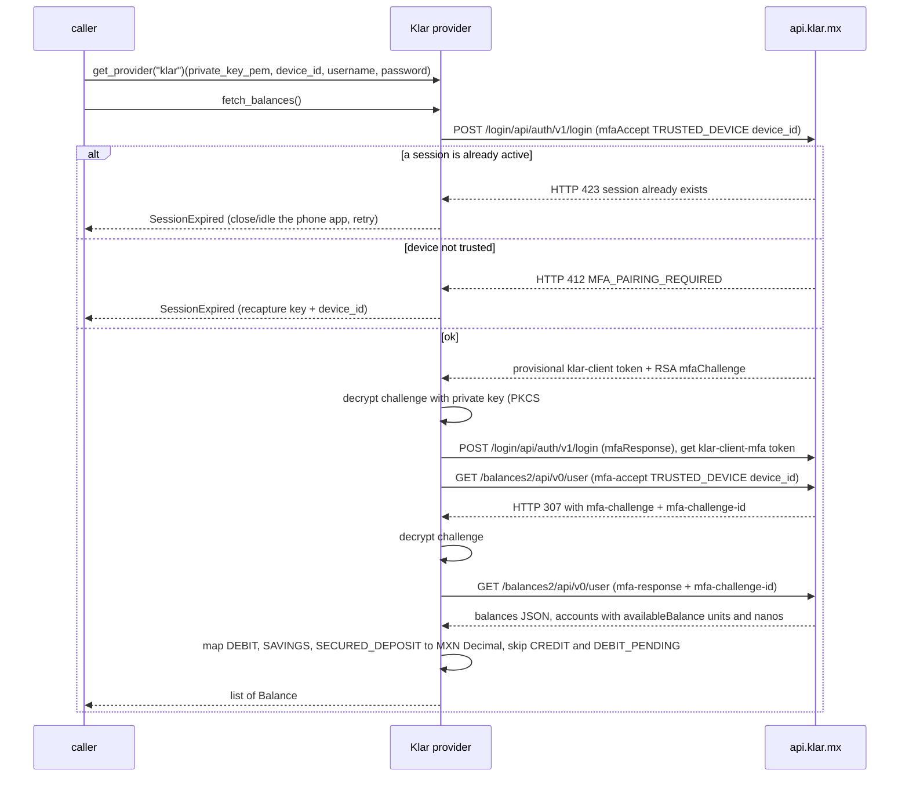

# Klar — flow

Getting the credentials: [`docs/credentials.md`](../credentials.md#klar).

Reads one `Balance` per non-credit account — `DEBIT` (Cuenta, checking), `SAVINGS` (Ahorro) and
`SECURED_DEPOSIT` (Depósito en garantía, investment) — in MXN. `CREDIT` (a credit line, not a holding) and
`DEBIT_PENDING` (unsettled) are excluded.

## Auth

The device RSA keypair plus its trusted-device id, captured once from the user's own **paired phone**, plus
the account `username` and `password`. Klar gates every data call with a per-request RSA challenge-response
bound to a trusted device, and pairing a *new* device is KYC-gated (face scan + SMS), so the library can't
enrol itself — it reuses the phone's already-registered key.

Klar pins its own hosts, so a normal capture doesn't work. What isn't pinned is Firebase Remote Config, and
a Remote Config flag unlocks a hidden "Inspect MFA keys" dev screen. So the proxy is used only to flip that
flag on the **first launch after a reinstall**, with the user signing in behind it; every pinned Klar host
passes through untouched. The dev screen then shows the device private key, and the device id comes from the
app's own logs (shared from the same menu once file logging is flagged on). The mitmproxy addon isn't
shipped; the `capture-credentials` skill has its spec. Full steps: [`docs/credentials.md`](../credentials.md#klar).

## Read — `fetch_balances()`

## Balance mapping

One `Balance` per non-credit account, by account `type`:

| `type` | Kind | Label |
|---|---|---|
| `DEBIT` | `checking` | Cuenta |
| `SAVINGS` | `savings` | Ahorro |
| `SECURED_DEPOSIT` | `investment` | Depósito en garantía |

`CREDIT` and `DEBIT_PENDING` are skipped on purpose, so the reported total mirrors the app's holdings.
Amounts arrive as `{units, nanos}` (nanos = 1e-9 of a unit) and are combined to 2-decimal MXN.

## Notes

- Klar allows **one active session per account**: while the phone app is signed in, login returns `423` and
  the read raises `SessionExpired`. Close or idle the phone app (its session lapses after ~30 min) and
  retry; logging the phone out does not un-pair it.
- After the read, the provider calls `POST gw.klar.mx/api/v2/auth/logout` (best-effort) to release its
  session, which otherwise lingers after the token expires and makes the next read — or the phone — hit
  `423`. Logout does not un-pair the device.
- The device key is software (pointycastle RSA-2048) stored in the phone's keychain; it survives app
  reinstalls, so a captured key keeps working until you re-pair (face + SMS), which rotates it.
- Klar's AWS load balancer rejects datacenter IPs: from a cloud server, login returns an HTML `403`
  (`awselb/2.0`). Pass the optional `proxy` auth value (`http://host:port`) to route this provider's calls
  through a residential connection, e.g. a home machine over Tailscale.
