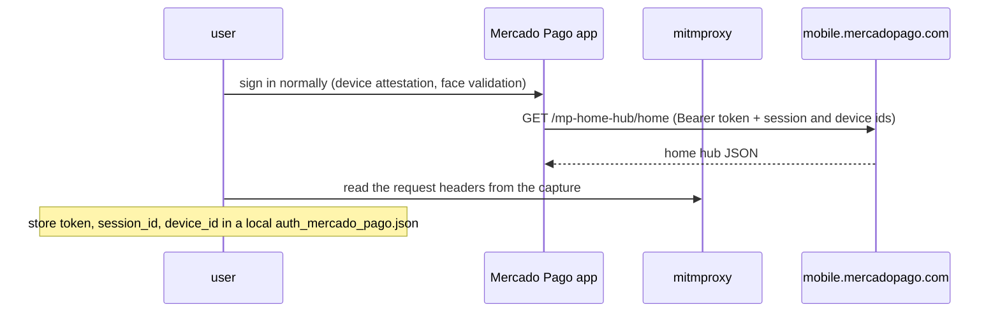
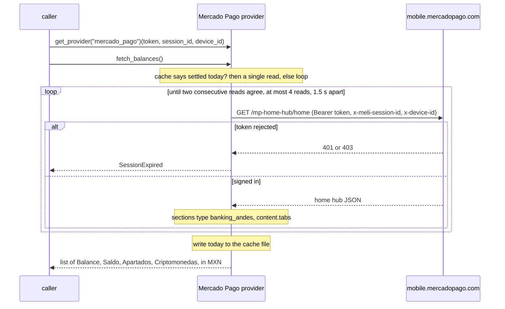

# Mercado Pago — flow

Getting the credentials: [`docs/credentials.md`](../credentials.md#mercado_pago).

Reads one `Balance` per tab of the home hub's banking section (Saldo, Apartados, Criptomonedas), in MXN.

## Auth

The signed-in mobile app's credentials, captured once by the user (e.g. with mitmproxy). The required ones
are the `Authorization: Bearer APP_USR-…` `token`, the MeLi `session_id` and the `device_id`;
`client_info`, `d2id`, `device_fsid` and `frontend_session_id` are optional fall-backs. App login needs
device attestation and a face-validation challenge that can't be reproduced off-device, so the provider
never logs in — it replays the captured session.

## Read — `fetch_balances()`

The first read of the day can return a stale snapshot, the same one the app paints before it refreshes. So
the day's first `fetch_balances()` re-reads until two consecutive reads agree; later calls that day read
once (the settled date is cached — see Notes).

## Balance mapping

In the `banking_andes` section, each tab's `banking_balance_andes` item carries `money_amount_items`, the
first already valued in MXN:

| Tab | Kind |
|---|---|
| Saldo | `checking` |
| Apartados | `savings` |
| Criptomonedas | `crypto` |

Saldo's second amount is a 12-month yield and is ignored. A missing section or non-MXN amount raises
`LayoutChanged`.

## Notes

- The Mexico City date the first read settled on is cached in `finscraper-mx/mercado_pago.json` under the
  user cache folder (`~/Library/Caches` on macOS, `%LOCALAPPDATA%` on Windows, `$XDG_CACHE_HOME` or
  `~/.cache` elsewhere, the temp folder with no home; override with `state_path=`), keyed by a hash of the
  `device_id` (stable for the install, unlike the session id). So later calls that day read once, even
  across runs. The file holds nothing secret; if it can't be read or written, every call reconciles.
