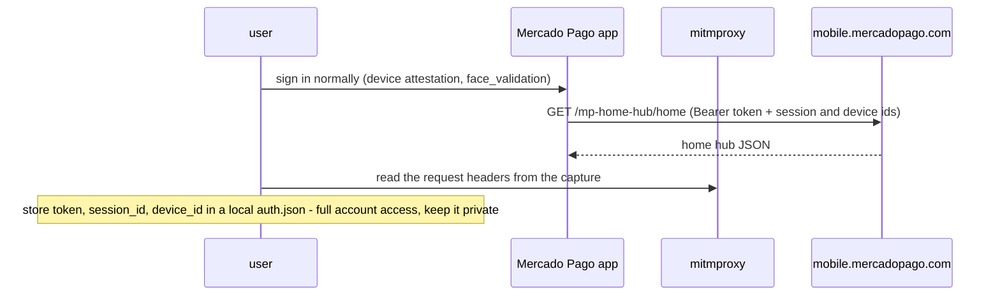
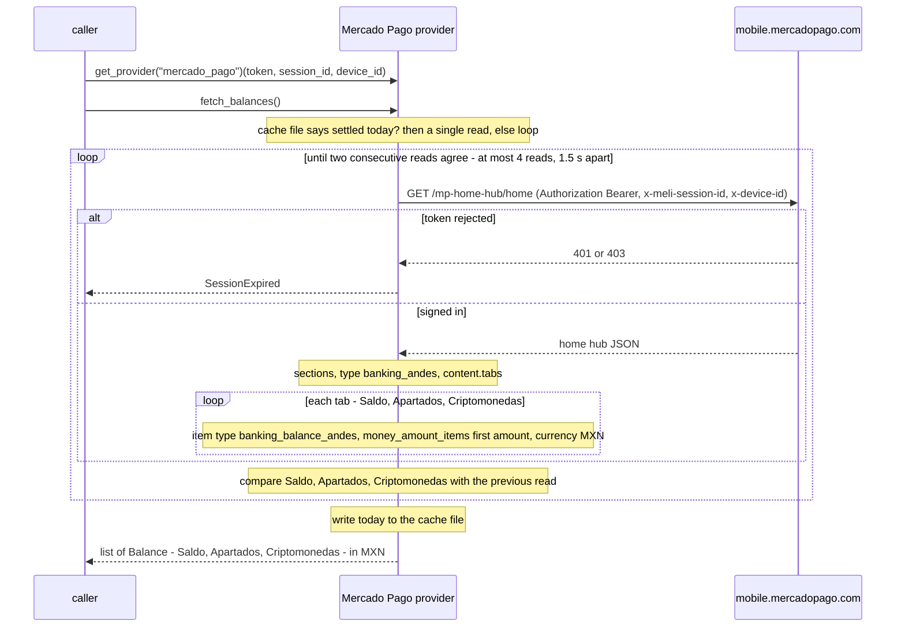

# Mercado Pago — flow

Auth: the signed-in mobile app's credentials, captured by the user (e.g. with mitmproxy). The required
ones are the `Authorization: Bearer APP_USR-…` `token`, the MeLi `session_id` and the `device_id`;
`client_info`, `d2id`, `device_fsid` and `frontend_session_id` are optional fall-backs. App login needs
device attestation and a face-validation challenge that can't be reproduced off-device, so the provider
never logs in; it replays the captured session. Reads one `Balance` per tab of the home hub's banking
section (Saldo, Apartados, Criptomonedas), in MXN.

The first read of the day can return a stale snapshot, the same one the app paints before it
refreshes. So the day's first `fetch_balances()` re-reads the home hub (1.5 s apart) until two consecutive
reads report the same amounts, at most four reads, returning the latest if they never agree. The Mexico City
date it settled on is cached in `finscraper-mx/mercado_pago.json` under the user cache folder
(`~/Library/Caches` on macOS, `%LOCALAPPDATA%` on Windows, `$XDG_CACHE_HOME` or `~/.cache` elsewhere,
the temp folder with no home; override with `state_path=`), keyed by a hash of the `device_id` (stable
for the install, unlike the session id), so later calls that day read once, even across runs. The file holds nothing secret; if it can't be read or written, every call reconciles.

## One-time setup (the user captures their own app session)

## Each read — `fetch_balances()`

