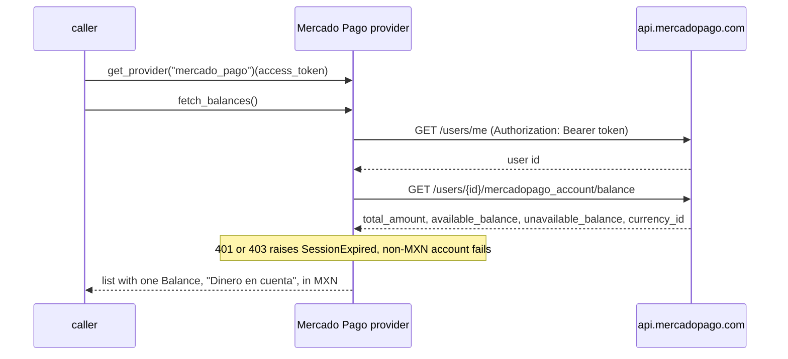

# Mercado Pago — flow

Auth: an access token (`access_token`, `APP_USR-…`) from an application created once in Mercado Pago
Developers. Reads one `Balance`: the account money (dinero en cuenta), in MXN. Cajitas are not included.

