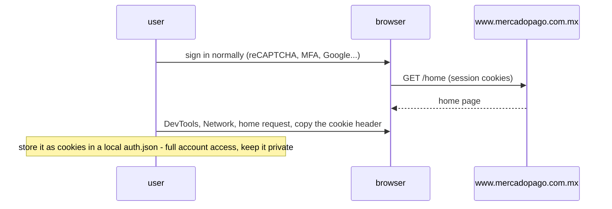
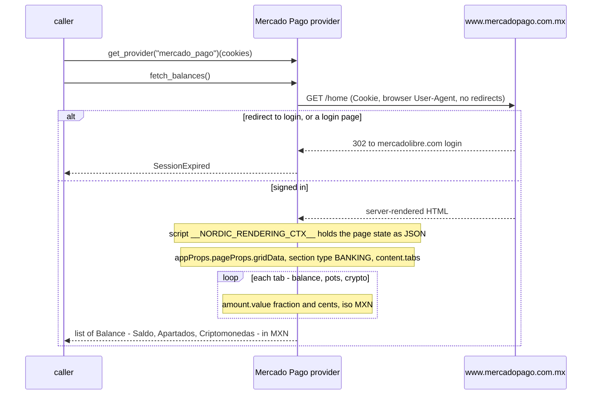

# Mercado Pago — flow

Auth: `cookies`, the `Cookie` request header of the user's own signed-in browser. The login is guarded
by reCAPTCHA and a browser check, so the provider never logs in; it reuses that session until it ends.
Reads one `Balance` per tab of the home page's balance widget (Saldo, Apartados, Criptomonedas), in MXN.

## One-time setup (in the user's browser)

## Each read — `fetch_balances()`

