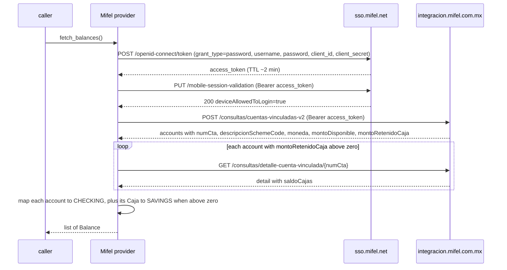

# Mifel (Banco Mifel) — flow

Getting the credentials: [`docs/credentials.md`](../credentials.md#mifel).

Reads one `Balance` per linked account (and its Caja), in MXN, from `sso.mifel.net` (Keycloak) and
`integracion.mifel.com.mx`.

## Auth

`username` and `password` — the same credentials used in the Mifel Móvil app. The provider logs in with the
**same Keycloak `grant_type=password` endpoint** as the app, which bypasses the web portal's Cronto
push-notification MFA. `client_id` and `client_secret` are the app's public credentials (same for every
user). The access token expires in about 2 minutes, so the library re-logs in on every `fetch_balances()`.

## Read — `fetch_balances()`

## Balance mapping

Each linked account yields one or two balances:

| Balance | Kind | Amount | Label |
|---|---|---|---|
| the account | `checking` | `montoDisponible` (available now) | `descripcionSchemeCode` (e.g. "Digital Evoluciona") |
| its Caja, only when `montoRetenidoCaja` > 0 | `savings` | `saldoCajas` (falls back to `montoRetenidoCaja` if the detail call has none) | label + " (Caja)" |

Currency comes from `moneda` (MXN).

## Notes

- `fingerprint` in the token request is a deterministic SHA-256 derived from the username; the server
  accepts any consistent value. `latitude`/`longitude` default to Mexico City (override with
  `location=(lat, lon)`).
- Errors: missing credential or Keycloak `401` → `AuthRequired`; Keycloak `5xx` or integracion `401/403` →
  `SessionExpired`; missing `access_token` or non-zero `codigo` → `LayoutChanged`.
- Login uses `curl-cffi` to impersonate an iOS TLS fingerprint and pass Mifel's Akamai WAF. Any capture
  (`*.har`) is gitignored; never commit one.
