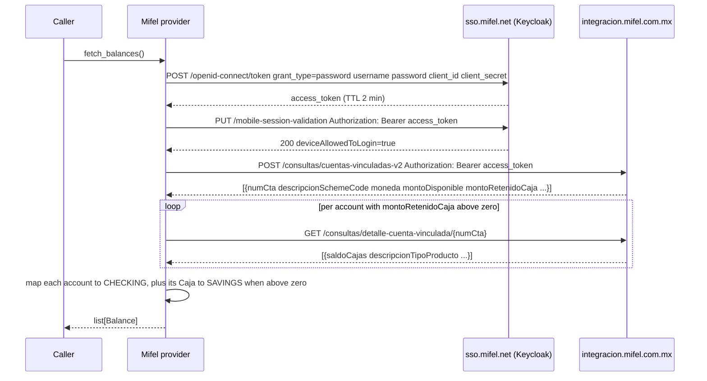

# Mifel (Banco Mifel) — call flow

Getting the credentials: [`docs/credentials.md`](../credentials.md#mifel).

Provider id: `mifel`  
API: `sso.mifel.net` (Keycloak) + `integracion.mifel.com.mx`

## Auth

`username` + `password` — same credentials used in the Mifel Móvil app.

The provider uses the **same Keycloak `grant_type=password` endpoint** as the Mifel Móvil app.
This bypasses the web portal's Cronto push-notification MFA entirely.
`client_id` and `client_secret` are the app's public credentials (same for every user).

The access token expires in **2 minutes**. The library re-logs in on every `fetch_balances()` call.

## Flow

## Balance mapping

Each linked account yields one or two balances:

| Balance | Kind | Amount | Label |
|---|---|---|---|
| the account | `CHECKING` | `cuentas.montoDisponible` (available now) | `descripcionSchemeCode` (e.g. "Digital Evoluciona") |
| its Caja, only when `montoRetenidoCaja` > 0 | `SAVINGS` | `detalle.saldoCajas` (falls back to `montoRetenidoCaja` if the detail call has none) | label + " (Caja)" |

Currency comes from `cuentas.moneda` (MXN).

## Error handling

| Condition | Exception |
|---|---|
| Missing `username` or `password` | `AuthRequired` |
| HTTP 401 from Keycloak | `AuthRequired` |
| HTTP 5xx from Keycloak | `SessionExpired` |
| Missing `access_token` in response | `LayoutChanged` |
| HTTP 401/403 from integracion | `SessionExpired` |
| Non-zero `codigo` from integracion | `LayoutChanged` |

## Notes

- The web portal login requires a Cronto push-notification MFA on every login. The app API
  uses `grant_type=password` directly, which bypasses that challenge.
- `fingerprint` in the token request is a deterministic SHA-256 derived from the username.
  The server accepts any consistent value.
- `latitude`/`longitude` default to Mexico City. Override with `location=(lat, lon)`.
- Any capture (`*.har`) is gitignored; never commit one.
