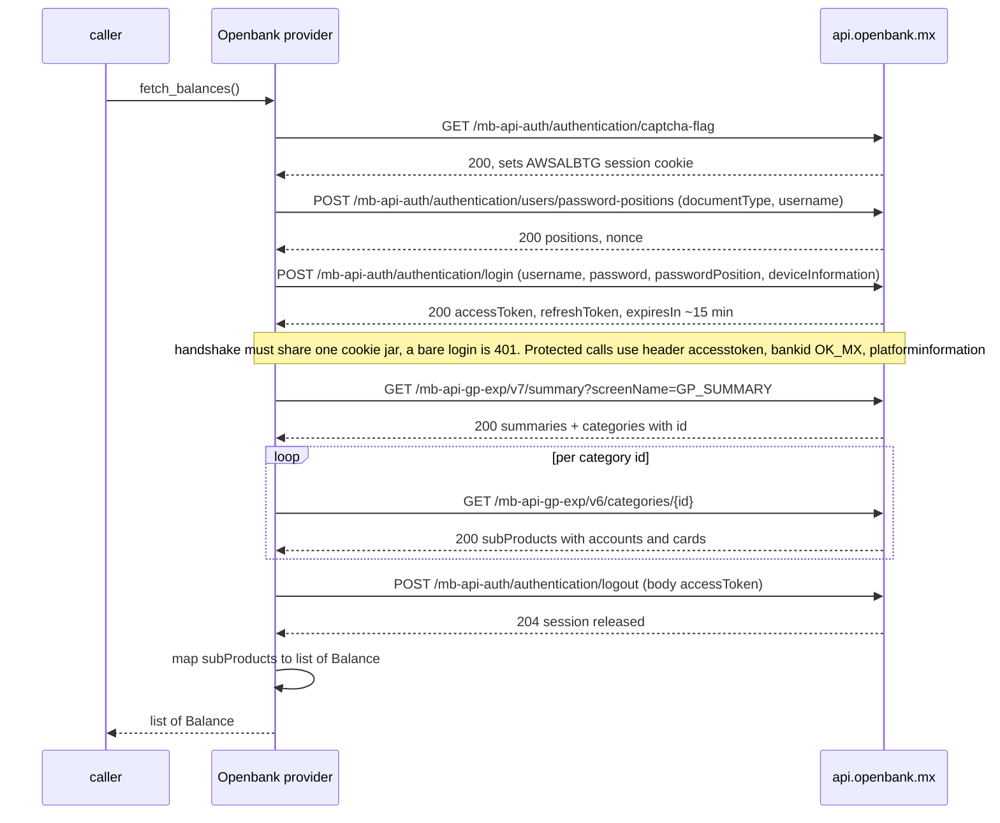

# Openbank México — flow

Getting the credentials: [`docs/credentials.md`](../credentials.md#openbank).

Reads one `Balance` per deposit/investment account, in MXN, from the Openbank MX app backend
(`api.openbank.mx`, Grupo Santander "modelbank"). Verified against a decrypted capture of
`mx.openbank.modelbank` v1.19.1.

## Auth

`username` + `password` + `device_uuid`.

- `username` is the login identifier (email by default; `document_type` can select others).
- `device_uuid` is the app's **registered trusted-device UUID**, captured once from the Android app
  (see [`docs/credentials.md`](../credentials.md#openbank)). It is sent both as
  `deviceInformation.deviceUUID` in the body and as `platforminformation.uuid` in the header.

Login is a 3-call handshake on one cookie-carrying client: `GET captcha-flag` (seeds the `AWSALBTG` session
cookie) → `POST users/password-positions` `{documentType, username}` (returns `positions` + a server
`nonce`) → `POST authentication/login` with `passwordPosition` = the returned positions (typically `["*"]`
= full password). A bare login without the handshake is rejected 401. The response carries an `accessToken`
(TTL ~15 min); every protected call sends it in a **custom `accesstoken:` header — not
`Authorization: Bearer`** — plus `bankid: OK_MX` and a `platforminformation` JSON header.

## Read — `fetch_balances()`

## Balance mapping

The global position is served by `GET /mb-api-gp-exp/v7/summary?screenName=GP_SUMMARY`, which returns
headline `summaries[]` plus a `categories[]` list of `{id}` (e.g. `c3`, `c12`). For each category id,
`GET /mb-api-gp-exp/v6/categories/{id}` returns `subProducts` with `accounts[]` and/or `cards[]`.

Only the `accounts[]` list is emitted, mapped by `subProductCode`:

| `subProductCode` | Kind | Amount |
|---|---|---|
| `CHECKING_ACCOUNT` | `checking` | `detailSummary.availableBalance` |
| `SAVINGS_ACCOUNT` (e.g. "Apartado") | `savings` | `detailSummary.availableBalance` |
| `INVESTMENT_ACCOUNT` | `investment` | `detailSummary.availableBalance` |

The `cards[]` list is not emitted: `DEBIT_CARD` mirrors its linked checking account, and `CREDIT_CARD` is
excluded (assets only, not credit). Account label = the product `alias`; currency from
`detailSummary.currency` (MXN). `fetch_balances()` always calls `logout` in a `finally` so the single
server session is released even on error.

## Notes

- Openbank's AWS load balancer rejects datacenter IPs: from a cloud server the login gets a `403`. Pass the
  optional `proxy` auth value (`http://host:port`, e.g. a Cloudflare WARP proxy) to route this provider's
  calls through another connection. Attestation present in the app (Play Integrity, ThreatMetrix) is
  telemetry only and does not gate the flow.
- **Why the patched capture was needed.** The global-position client pins TLS programmatically via an
  R8-obfuscated OkHttp `CertificatePinner` (and builds a Cronet engine with `addPublicKeyPins`),
  independent of the network-security-config. Capturing it required a patched app: PairIP license check
  no-op, `gs-configuration.json` `enableCertificate:false` / `enabledHighSecurityLevel:false`, Cronet
  builder stubbed to return null, and the obfuscated `CertificatePinner.check` method stubbed to
  `return-void`.
