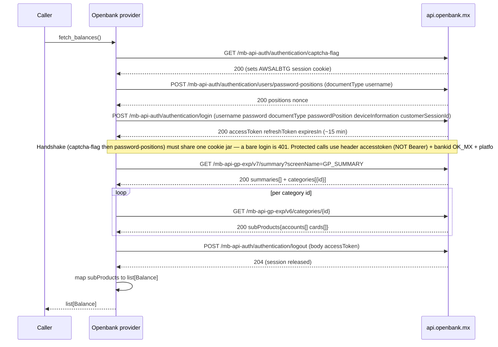

# Openbank México — call flow

Provider id: `openbank`
API: `api.openbank.mx` (Grupo Santander "modelbank" / Openbank MX app backend)

## Status

**Implemented and verified** against a decrypted capture of the Openbank MX app
(`mx.openbank.modelbank` v1.19.1): login handshake + the global-position balance read.

## Auth

`username` + `password` + `device_uuid`.

- `username` is the login identifier (email by default; `document_type` can select others).
- `device_uuid` is the app's **registered trusted-device UUID**, captured once from the app
  or a proxy. It is sent both as `deviceInformation.deviceUUID` in the body and as
  `platforminformation.uuid` in the header — they are the same value.

Login is a 3-call handshake on one cookie-carrying client: `GET captcha-flag` (seeds the
`AWSALBTG` session cookie) → `POST users/password-positions` `{documentType, username}`
(returns `positions` + a server `nonce`) → `POST authentication/login` with
`passwordPosition` = the returned positions (typically `["*"]` = full password, no
positional challenge). A bare login without the handshake is rejected 401. The response carries an
`accessToken` (TTL ~15 min) and a `refreshToken`. Every protected call then sends the token
in a **custom `accesstoken:` header — not `Authorization: Bearer`** — plus `bankid: OK_MX`
and a `platforminformation` JSON header. No per-request device-nonce signing was observed on
the login or customer-summary calls.

Openbank's AWS load balancer rejects datacenter IPs: from a cloud server the login gets a `403`
whatever the credentials. Pass the optional `proxy` auth value (`http://host:port`, e.g. a Cloudflare
WARP proxy) to send this provider's calls, and only these, through another connection.

Attestation present in the app (Play Integrity, ThreatMetrix) is **telemetry only** — not a
client-side hard gate — so headless login works without it.

## Flow

## Balance mapping

The global position (home-screen balances) is served by `GET /mb-api-gp-exp/v7/summary?screenName=GP_SUMMARY`,
which returns headline `summaries[]` plus a `categories[]` list of `{id}` (e.g. `c3`, `c12`). For each
category id, `GET /mb-api-gp-exp/v6/categories/{id}` returns `subProducts` with `accounts[]` and/or `cards[]`.

Only the `accounts[]` list is emitted, mapped by `subProductCode`:

| `subProductCode` | `AccountKind` | amount |
|---|---|---|
| `CHECKING_ACCOUNT` | `checking` | `detailSummary.availableBalance` |
| `SAVINGS_ACCOUNT` (e.g. "Apartado") | `savings` | `detailSummary.availableBalance` |
| `INVESTMENT_ACCOUNT` | `investment` | `detailSummary.availableBalance` |

The `cards[]` list is **not** emitted: `DEBIT_CARD` mirrors its linked checking account, and
`CREDIT_CARD` is intentionally excluded (the provider reports assets only, not credit).

Account label = the product `alias`. Amounts are `Decimal`, currency from `detailSummary.currency` (MXN).
`fetch_balances()` always calls `logout` in a `finally` so the single server session is released even on error.

### Why the patched capture was needed

The global-position client pins TLS programmatically via an R8-obfuscated OkHttp `CertificatePinner`
(and also builds a Cronet engine with `addPublicKeyPins`), independent of the network-security-config.
Capturing it required a patched app: PairIP license check no-op, `gs-configuration.json`
`enableCertificate:false`/`enabledHighSecurityLevel:false`, Cronet builder stubbed to return null, and the
obfuscated `CertificatePinner.check` method stubbed to `return-void`. Attestation (Play Integrity,
ThreatMetrix) is telemetry only and does not gate the flow.
