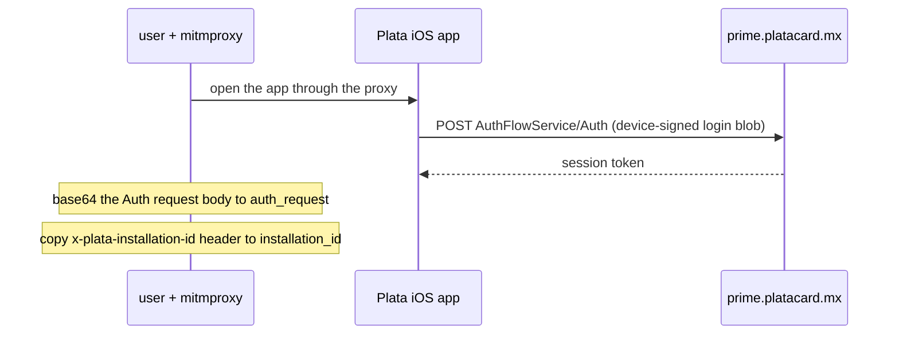
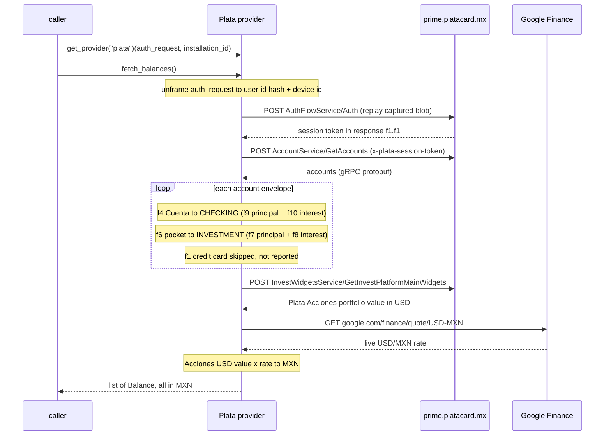

# Plata — flow

Getting the credentials: [`docs/credentials.md`](../credentials.md#plata).

Reads the Cuenta and savings/investment pockets plus the Plata Acciones brokerage portfolio, all in MXN,
from the Plata mobile app's gRPC-over-HTTP/2 backend on `prime.platacard.mx` (behind Cloudflare; no cert
pinning on the backend).

## Auth

A captured **Auth request** (`auth_request`, base64 of the raw gRPC request body) plus the
`installation_id` header, both grabbed once from a mitmproxy session. The login blob inside the Auth
request is signed by the device key and can't be rebuilt off-device, so the provider replays it verbatim to
mint a fresh `x-plata-session-token` on each run. The user-id hash and device id used on read calls are read
back out of the captured blob.

`auth_request` is base64 of the raw gRPC request body of one real `AuthFlowService/Auth` call. gRPC frames
a request as one flag byte, a 4-byte length, then a protobuf message; `auth_request` is those bytes,
unchanged. The message has three fields:

| Field | Contents | Used for |
|---|---|---|
| `f1` | **user-id hash** — a 64-char hex string identifying the account | `x-plata-user-id-hash` header on reads |
| `f2` | the **device-signed login blob** — ~344 opaque bytes from the phone's secure element | proof of login the server verifies |
| `f3` | **device metadata** — the device id (a UUID) plus model / OS / screen | `x-plata-device-id` header on reads |

`installation_id` (the `x-plata-installation-id` header) is not inside the blob — it is install-level
telemetry sent as its own header — so it is a separate auth field.

## Read — `fetch_balances()`

## Balance mapping

`GetAccounts` returns a wrapper (`f1`) holding a repeated account envelope (`f1`) and a summary (`f2`). Each
envelope wraps its body under one field that identifies the product. Amounts are Google-`Money`-style
messages `{f1: currency, f2: units, f3: nanos}`. Both the Cuenta and the pockets carry a principal and the
accrued-but-unpaid interest; the reported balance is the two added together.

| Envelope | Product | Kind | Balance | Reported? |
|---|---|---|---|---|
| `f4` | Cuenta (debit) | `checking` | `f9` principal + `f10` interest | yes |
| `f6` | named savings/investment pocket | `investment` | `f7` principal + `f8` interest | yes |
| `f1` | primary Mastercard credit card | — | owed = limit `f10` − available `f12` | no — skipped |

Pocket figures are cross-checked against the summary block (`f2`): per-pocket `f7` principals sum to
`f2.f2`, and per-pocket `f8` interest sums to `f2.f3`. The credit card is intentionally not reported (reads
are debit + investment only) but its shape is kept here so it is easy to re-add.

**Plata Acciones (brokerage).** `InvestWidgetsService/GetInvestPlatformMainWidgets` (empty request) returns
the portfolio; its total is a `Money` at `f1 → f1 → f1 → f3`, in **USD**. To keep every balance in MXN the
provider converts it at Google Finance's live USD/MXN rate (`google.com/finance/quote/USD-MXN`). Pass
`usd_mxn_rate=` to override the rate (and to avoid the network, as the tests do).

## Notes

- The blob is **long-lived** — a captured request was still minting fresh session tokens ~10 hours after
  capture (exact lifetime unknown). It is invalidated when Plata rotates the device key (logout, reinstall,
  new phone); then the `Auth` call comes back empty and the provider raises `SessionExpired` with a
  "recapture auth_request" hint naming the rejected call (`Auth`, `GetAccounts`, or the invest widget).
- **No `content-length`.** The invest gateway rejects a request carrying a `content-length` header
  (`grpc-status 13`, its upstream "get accounts" call resets). A real gRPC client sends the body as HTTP/2
  DATA frames with no `content-length`; httpx adds one for a `bytes` body, so every call sends its body via
  `_grpc_frame()` (a one-item stream) to make httpx omit it.
- The Acciones read is wrapped **best-effort**: if the invest gateway fails, `fetch_balances()` omits Plata
  Acciones and emits a `UserWarning` (carrying the server's `grpc-status`) rather than raising, so the
  Cuenta and pocket balances are never blocked by a brokerage-side hiccup.
