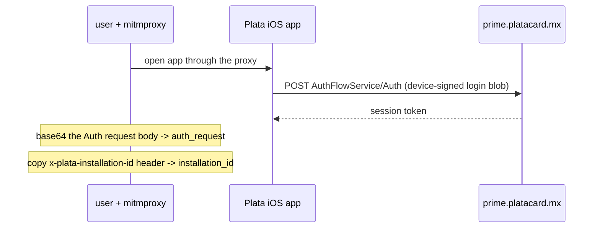
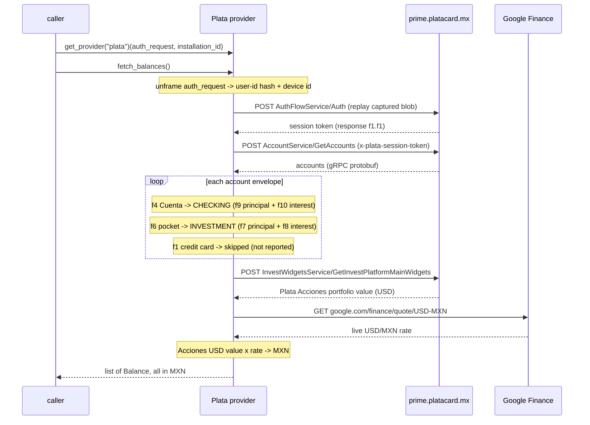

# Plata — flow

Getting the credentials: [`docs/credentials.md`](../credentials.md#plata).

Auth: a captured **Auth request** (`auth_request`, base64 of the raw gRPC request body) plus the
`installation_id` header, both grabbed once from a mitmproxy session. Plata's backend is
gRPC-over-HTTP/2 on `prime.platacard.mx` (behind Cloudflare; no cert pinning on the backend). The login
blob inside the Auth request is signed by the device key and can't be rebuilt off-device, so the provider
replays it verbatim to mint a fresh `x-plata-session-token` on each run, then reads balances. The user-id
hash and device id used on read calls are read back out of the captured blob.

## The `auth_request` blob

`auth_request` is **base64 of the raw gRPC request body** of one real `AuthFlowService/Auth` call,
captured from the app. gRPC frames a request as one flag byte, a 4-byte length, then a protobuf message;
`auth_request` is those bytes, unchanged. The protobuf message has three fields:

| Field | Contents | Used for |
|---|---|---|
| `f1` | **user-id hash** — a 64-char hex string identifying the account | sent as the `x-plata-user-id-hash` header on reads (read back out of the blob) |
| `f2` | the **device-signed login blob** — ~344 opaque bytes produced by the phone's secure element when you unlock (Face ID / PIN) | proof of login; this is what the server verifies |
| `f3` | **device metadata** — the device id (a UUID) plus model / OS / screen | the device id is sent as the `x-plata-device-id` header on reads (read back out of the blob) |

`installation_id` (the `x-plata-installation-id` header) is **not** inside the blob — it is install-level
telemetry sent as its own header — so it is supplied as a separate auth field.

### Why replaying it works, and when it stops

`f2` is a signature/ciphertext the server can verify but that cannot be forged or regenerated off the
device — so the provider never rebuilds the request, it sends the captured bytes **byte-for-byte**. The
server validates the signature and returns a brand-new session token each time, so one capture mints many
fresh tokens.

The blob is **long-lived** — a captured request was still minting fresh session tokens ~10 hours after
capture (exact lifetime unknown). It is invalidated when Plata rotates the device key (logout, reinstall,
new phone); when that happens the `Auth` call comes back empty and the provider raises
`SessionExpired` with a "recapture auth_request" hint, so you recapture the Auth call and regenerate
`auth_plata.json`. The error message names which call was rejected (`Auth`, `GetAccounts`, or the invest
widget).

### How to get it (overview)

1. Put a proxy (mitmproxy) in front of your iPhone and trust its CA so TLS is readable — Plata does not
   pin its own backend, so the flows are plaintext in the proxy.
2. Open the Plata app and let the home screen load; this fires the `AuthFlowService/Auth` call.
3. In the capture, find the `POST` to `prime.platacard.mx/…/AuthFlowService/Auth` and take two things:
   its **raw request body** → base64 → `auth_request`; and its **`x-plata-installation-id`** header →
   `installation_id`. Drop both into `auth_plata.json`.

Step by step, including a snippet that builds `auth_plata.json` from a saved mitmproxy capture:
[`docs/credentials.md`](../credentials.md#plata).

## One-time setup — capture with mitmproxy

## Each read — `fetch_balances()`

## Response field map (reverse-engineered)

`GetAccounts` returns a wrapper (`f1`) holding a repeated account envelope (`f1`) and a summary (`f2`).
Each envelope wraps its body under one field that identifies the product. Amounts are
Google-`Money`-style messages `{f1: currency, f2: units, f3: nanos}`.

Both the Cuenta and the pockets carry two money fields: the **principal** and the **interest that has
accrued but not yet been paid out**. Plata's real spendable value is the two added together, so each
reported balance is `principal + accrued interest`.

| Envelope wrapper | Product | Kind | Balance | Reported? |
|---|---|---|---|---|
| `f4` | Cuenta (debit) | `CHECKING` | `f9` principal + `f10` interest | yes |
| `f6` | named savings/investment pocket | `INVESTMENT` | `f7` principal + `f8` interest | yes |
| `f1` | primary Mastercard credit card | — | owed = limit `f10` − available `f12` | no — skipped |

The pocket figures are cross-checked against the summary block (`f2`): the per-pocket `f7` principals sum
to the summary total (`f2.f2`), and the per-pocket `f8` interest sums to the summary interest total
(`f2.f3`). The credit card (envelope `f1`) is intentionally not reported — reads are debit + investment
only — but its shape is kept here so it is easy to re-add.

## Plata Acciones (brokerage)

A second call, `InvestWidgetsService/GetInvestPlatformMainWidgets` (empty request), returns the Plata
Acciones portfolio. Its total value is a `Money` at `f1 → f1 → f1 → f3`, denominated in **USD**. To keep
every balance in MXN, the provider converts it using Google Finance's live USD/MXN rate
(`google.com/finance/quote/USD-MXN`, parsed from the quote embedded after the `"USD / MXN"` title). The
caller can pass `usd_mxn_rate=` to override the rate (and to avoid the network, as the tests do).

**No `content-length`.** The invest gateway rejects a request that carries a `content-length` header: it
answers `grpc-status 13` (INTERNAL) with `"failed to get accounts: … RST_STREAM / PROTOCOL_ERROR"` (its
upstream "get accounts" call reset). A real gRPC client sends the body as HTTP/2 DATA frames with no
`content-length`; httpx adds one for a `bytes` body. The accounts gateway tolerates it, but the invest one
does not — so every call sends its body via `_grpc_frame()` (a one-item stream), which makes httpx omit
`content-length`. This was the only blocker; with it fixed the widget returns the portfolio normally.

The read is still wrapped **best-effort**: if the invest gateway ever fails, `fetch_balances()` omits
Plata Acciones and emits a `UserWarning` (carrying the server's `grpc-status`) rather than raising, so the
Cuenta and pocket balances are never blocked by a brokerage-side hiccup.
