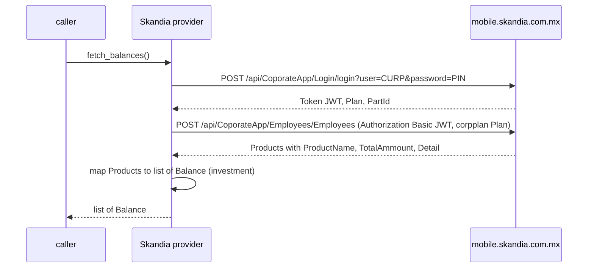

# Skandia México — flow

Getting the credentials: [`docs/credentials.md`](../credentials.md#skandia).

Reads one `Balance` per corporate savings product (Fondo de Ahorro), in MXN, from the SKANDIA NET MX mobile
app backend (`mobile.skandia.com.mx`).

## Auth

`username` (CURP, 18 characters) + `password` (6-digit numeric PIN) — the same credentials as the web
portal and mobile app. No captcha or OTP: the app API takes the CURP and PIN directly. The JWT it returns
expires in about 20 minutes, so the provider re-logs in on every `fetch_balances()` and never caches a
session.

## Read — `fetch_balances()`

## Balance mapping

One `Balance` per entry in the `Products` array returned by `Employees`:

| Source field | Used for |
|---|---|
| `ProductName` (e.g. "FONDO DE AHORRO") | account label |
| `TotalAmmount` | amount (`Decimal`, MXN) |
| — | kind is always `investment` |

The per-contributor breakdown (`Detail[]`, e.g. APORTACION EMPLEADO / EMPRESA) is not emitted; the
reported balance is the product's `TotalAmmount`.

## Notes

- Errors: missing credential, login `401`, or a null `Token` / error message → `AuthRequired`; login `5xx`
  or Employees `401/403` → `SessionExpired`; missing or empty `Products` → `LayoutChanged`.
