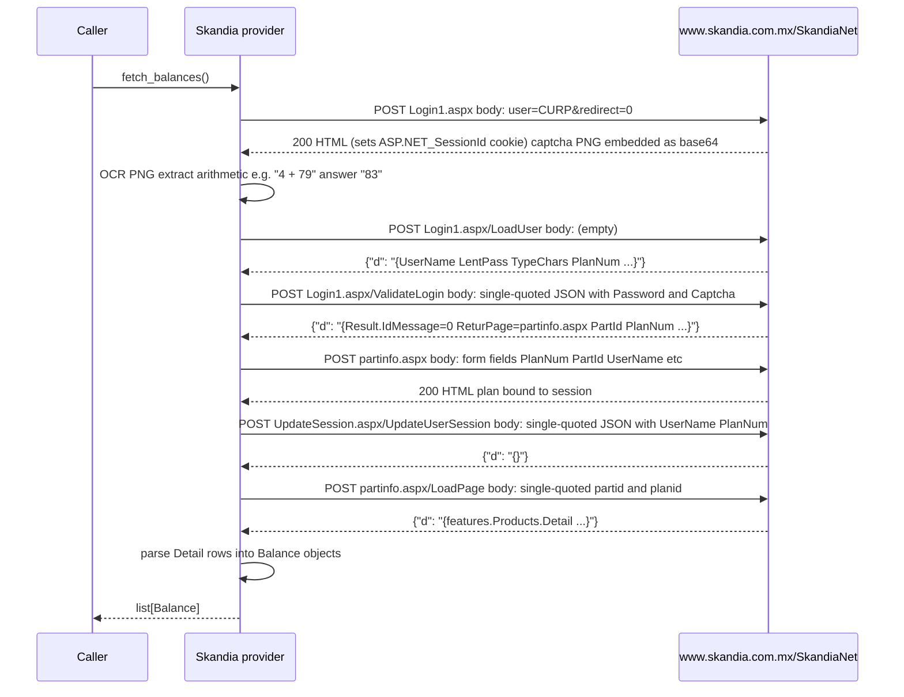

# Skandia México — call flow

Provider id: `skandia`  
Portal: [www.skandia.com.mx/SkandiaNet](https://www.skandia.com.mx/SkandiaNet)  
Product: corporate Fondo de Ahorro (Portal-Corp)

## Auth

`username` (CURP, 18 chars) + `password` (6-digit numeric PIN).

The login page renders a server-side arithmetic captcha as a PNG image. The provider OCR-solves
it on every call with `pytesseract` + `Pillow`. The `tesseract-ocr` binary, **version 5.5 or newer**, must be installed (5.3.4, the Ubuntu 24.04
default, misreads some real captchas). Check with `tesseract --version`:

```bash
brew install tesseract          # macOS
apt-get install tesseract-ocr   # Debian/Ubuntu: check the version, the distro package may be older
```

## Flow



## Request body format

All XHR bodies use single-quoted outer objects — ASP.NET WebMethod accepts this:

| Endpoint | Body |
|---|---|
| `Login1.aspx` | `user=CURP&redirect=0` (form-encoded) |
| `LoadUser` | *(empty)* |
| `ValidateLogin` | `{'request':'{"Password":"...","Captcha":"83"}'}` |
| `partinfo.aspx` | `PlanNum=...&PartId=...&UserName=...&...` (form-encoded) |
| `UpdateUserSession` | `{'req':'{"UserName":"...","PlanNum":"..."}'}` |
| `LoadPage` | `{'partid':'...', 'planid':'...'}` |

## Response envelope

Every XHR response is `{"d": "<JSON string>"}` — the inner string must be `json.loads`'d a second time.

### LoadPage — `features.Products.Detail`

```json
[
  ["S,T", "FONDO DE AHORRO", "$12,345.67"]
]
```

Each row: `[sources_csv, product_name, "$amount"]`. One `Balance(AccountKind.INVESTMENT)` is
emitted per row.

## Error handling

| Condition | Exception |
|---|---|
| Missing `username` or `password` | `AuthRequired` |
| Wrong password or captcha (`IdMessage=20`) | `AuthRequired` |
| Account locked or other `IdMessage` | `SessionExpired` |
| HTTP 401 / 403 | `SessionExpired` |
| `LoadPage` returns a login redirect | `SessionExpired` |
| Unexpected JSON shape | `LayoutChanged` |
| OCR cannot parse the captcha image | `LayoutChanged` |

## Notes

- The ASP.NET session expires after **30 idle minutes**. `fetch_balances()` performs a fresh
  login on every call so the caller never has to manage session state.
- `ValidateLogin` returns `PlanNum` and `PlanName` with inconsistent semantics across accounts;
  the provider tries both keys.
- `PersonalData` in the LoadPage response contains PII (name, CURP, address, email). The provider
  ignores it entirely and never logs it.
- The HAR captures (`*.har`) are gitignored; never commit them.
